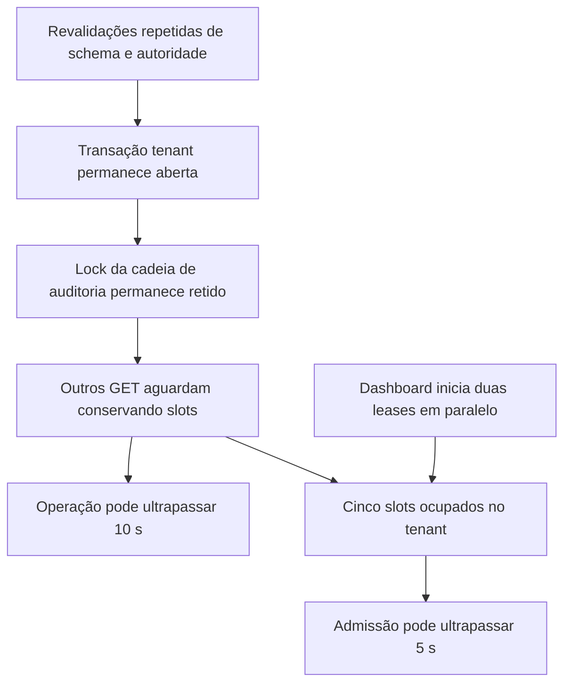

# Contenção de autoridade e pool — investigação

Pergunta: que mecanismos explicam `LEASE_TIMEOUT` e `POOL_EXHAUSTED` sob carga HTTP real, e qual é a primeira redução de custo que preserva os contratos de autoridade?

Âmbito autorizado: analisar o código e a evidência anterior; executar instrumentação de diagnóstico apenas em contentores exclusivos, com dados sintéticos, OIDC e roles reais. Não alterar código da aplicação, migrations, grants, permissões, dados Dev, dependências ou deploy. Não aumentar limites nem desativar verificações para obter sucesso.

A evidência anterior é [o gate de sessões/HTTP](../reviews/http-session-epochs/README.md): 101/108 sucessos, seis `LEASE_TIMEOUT` e um `POOL_EXHAUSTED`. A nova investigação separa tempo de aquisição de ligações, capacidade lógica do gestor, verificação de schema/ACL, aquisição/retenção de locks e execução do SQL de dados, comparando concorrência e concentração no mesmo tenant. Não permite concluir capacidade produtiva a partir do ambiente local.

Investigação concluída em 26/10/2026: a contenção principal observada nos relatórios é a cadeia de auditoria tenant, cuja retenção é prolongada pelas revalidações. A admissão de leases do dashboard também satura. O checkout físico PostgreSQL permaneceu rápido nos ensaios; não há fundamento nestes resultados para começar por aumentar o pool. Esta é uma recomendação de investigação, não uma decisão de arquitetura aprovada.

## Factos medidos

Dois ensaios novos, com PostgreSQL 17/Keycloak, login OIDC real, roles limitadas/RLS, 1000 candidaturas e 250 pessoas por tenant. Não foram alterados limites, verificações, permissões ou fontes da aplicação. [Resultados do ensaio standard](../reviews/authority-contention/results.json), [resumo calculado](../reviews/authority-contention/summary.json), [burst de capacidade](../reviews/authority-contention-capacity/results.json) e [resumo do burst](../reviews/authority-contention-capacity/summary.json).

| Percurso | Concorrência / tenants | Sucessos | p50 / p95 HTTP (ms) | Slots / fila máximos | Amostras com bloqueio de auditoria |
|---|---:|---:|---:|---:|---:|
| Report | 1 / 1 | 4/4 | 5607 / 6353 | 1 / 0 | 0/221 |
| Report | 2 / 1 | 4/4 | 5338 / 7455 | 2 / 0 | 20/124 |
| Report | 4 / 1 | 7/8 | 9084 / 10893 | 4 / 0 | 151/213 |
| Dashboard | 1 / 1 | 4/4 | 8403 / 9128 | 2 / 0 | 0/329 |
| Dashboard | 4 / 1 | 8/8 | 15177 / 15641 | 5 / 3 | 207/300 |
| Dashboard | 4 / 2 | 8/8 | 13480 / 16957 | 8 / 0 | 28/274 |
| Dashboard, burst adicional | 6 / 1 | 2/6 | 18103 / 18832 | 5 / 7 | consultar resumo do burst |

Os quantis incluem só respostas 200. Os dois quantis do burst assentam em apenas dois sucessos. As proporções de amostras não são percentagens exatas do tempo. O ensaio standard recolheu 1872 amostras; o burst, 261, incluindo aquecimento e drenagem. O segundo tenant não foi previamente aquecido no cenário misto standard; a comparação de latência entre um e dois tenants não é uma estimativa causal isolada.

### 1. Há custo elevado antes de existir contenção

Em report C1, a média acumulada das consultas de metadados foi **4574 ms por pedido**, enquanto a seleção de candidaturas demorou **18,4 ms**. No ensaio standard, cada report abriu exatamente **21 transações centrais de autoridade** e cada dashboard, **42**. No perfil anterior, browse abria 19.

Cada transação coordenada tem 35 chamadas de infraestrutura antes do SQL funcional: 20 classificadas como metadata, 11 como other e quatro comandos transacionais. Executa um preflight com BEGIN/COMMIT, seguido da transação protegida com outro BEGIN/COMMIT. O mesmo catálogo de segurança é recolhido quatro vezes: dentro do fingerprint de schema, na assertion complementar, depois do preflight e depois de adquirir o lock central. [Coordenador](../../backend/src/security/authorityCoordinator.js#L39), [snapshot/assertion](../../backend/src/security/centralSchemaManifest.js#L88), [admissão](../../backend/src/security/authoritySecurityManifest.js#L60).

`guardIdentity` e `resolve` fazem validações integrais separadas e são repetidos dentro de prepare; cada autorização adicional volta a consultar membership/grants. São fronteiras legítimas de segurança, mas há material repetido dentro delas. [Protect](../../backend/src/security/authorityCoordinator.js#L200), [autoridade autenticada](../../backend/src/security/authenticatedAuthority.js#L37), [serviço de autorização](../../backend/src/authorization/authorizationService.js#L44).

### 2. O lock de auditoria é a espera dominante no report concorrente

O hash lento `1130bb78a9ac28aa` corresponde a `audit.prepare_append_v1`. Esta função bloqueia `audit.chain_head` por organização/stream com `FOR UPDATE`; as leituras de candidaturas usam ACCESS. O lock permanece até ao commit tenant, depois das revalidações finais e da inspeção física. [Chamada](../../backend/src/audit/postgresAppendRepository.js#L4), [contrato SQL existente](../../backend/database/tenant/migrations/002_f7_append_only_audit.up.sql#L119), [ordem de finalização](../../backend/src/security/tenantLeaseExecutor.js#L129).

`pg_blocking_pids` confirmou outras transações tenant como bloqueadores, com waits `transactionid`/`tuple`. Vários titulares estavam `idle in transaction / ClientRead`, conservando a transação aberta enquanto o código aguardava outros passos. A interpretação dos waits segue [a documentação PostgreSQL 17](https://www.postgresql.org/docs/17/monitoring-stats.html).

A média acumulada de `audit.prepare` por report cresceu de **6,6 ms (C1)** para **517 ms (C2)** e **3235 ms (C4)**. O débito de sucessos foi 0,173 → 0,311 → 0,314 pedidos/s: aumentar de dois para quatro pedidos deixou praticamente de aumentar o débito, mas aumentou a espera e introduziu uma falha.

O report C4 que falhou teve checkout tenant de 16,61 ms, seleção funcional de 17 ms, aproximadamente 6377 ms em preparação da auditoria e ligação retida por 10668 ms. O erro foi `LEASE_TIMEOUT`; o gestor não tinha fila e usava no máximo quatro slots. A explicação é consumo do orçamento da operação durante a transação, não falta de ligações físicas.

### 3. O lock central é global e acrescenta contenção

O hash `e457b9e54eecca47` é o advisory lock `(43001306,1)`, partilhado por todos os tenants. Ficou bloqueado em 69/300 amostras do dashboard C4 e em 75/274 com dois tenants. Porém, no report C4 a chamada de lock central acumulou em média **188 ms/pedido**, contra 3235 ms em auditoria. Não é correto apresentar o lock central como a maior espera de todos os cenários. [Aquisição e commit](../../backend/src/security/authorityCoordinator.js#L45).

Há acoplamento nos dois sentidos: o tenant conserva o lock de auditoria enquanto revalida a autoridade; a transação central pode aguardar auditoria tenant emitida por `authorize`. A auditoria observacional usa timeout de 100 ms; o append continua pendente e `drain` aguarda-o depois do retorno de protect. Isto sustenta risco de espera circular temporária e acumulação de filas, não prova deadlock PostgreSQL persistente. [Timeout de auditoria](../../backend/src/authorization/resourceAuthorization.js#L15), [emissão](../../backend/src/authorization/audit.js#L81), [drain](../../backend/src/applications/composition.js#L124).

### 4. POOL_EXHAUSTED foi reproduzido na admissão, antes do checkout

O runtime usa cinco ligações/slots por tenant, fila de dez, aquisição de 5 s, lease de 15 s e operação de 10 s. A lease começa após a concessão da ligação; a preparação já consome o seu prazo. O orçamento da operação inclui verificação física, SQL funcional, auditoria, revalidações, commit e conclusão do guard. [Política real](../../backend/src/config/opportunityRuntime.js#L49), [concessão](../../backend/src/security/tenantPoolManager.js#L474), [deadline da operação](../../backend/src/security/tenantLeaseExecutor.js#L269).

O dashboard lança duas operações tenant em paralelo, além do catálogo central, e depois usa uma terceira lease para a validação final. Quatro pedidos podem disputar oito leases iniciais para cinco slots. [Rota](../../backend/src/routes/organizationDashboardRoutes.js#L29).

Em C4 foram observados cinco slots ocupados e três tarefas em fila, mas checkout tenant máximo de 41,72 ms. O burst C6 fechou a atribuição:

- 14 aquisições: nove concedidas e **cinco expiradas aos 5000,17–5001,92 ms**, distribuídas por três pedidos HTTP;
- exatamente nove checkouts físicos tenant, sem erro de checkout, máximo 68,96 ms;
- máximo de cinco ativos e sete em fila, abaixo do limite de dez;
- três HTTP falharam por aquisições expiradas e um quarto por `LEASE_TIMEOUT`.

Logo, neste burst `POOL_EXHAUSTED` significa **timeout da admissão**, e não rejeição imediata por fila cheia ou timeout do checkout PostgreSQL. Esta reprodução explica um mecanismo real; não permite atribuir retroativamente todos os detalhes do erro da corrida anterior, que não tinha esta telemetria. O significado de `totalCount`, `idleCount` e `waitingCount` é o definido pelo [node-postgres](https://node-postgres.com/apis/pool).

### 5. Trabalho continua depois de uma resposta de erro do dashboard

Num pedido C6, um ramo recebeu uma lease e outro expirou na admissão. Depois da resposta 503 foram registadas **772 conclusões de queries**: 536 na autoridade, quatro no leitor central e 232 no tenant. Incluem metadata; não são 772 consultas funcionais nem necessariamente 772 queries iniciadas depois da resposta. A rota responde quando `Promise.all` rejeita, sem cancelar os ramos restantes. [Composição e catch](../../backend/src/routes/organizationDashboardRoutes.js#L29).

## Recomendação e alternativas

**Priorizar a redução de trabalho repetido nas mesmas fronteiras de validação.** Recolher metadata de forma canónica em menos round-trips e reutilizar a mesma fotografia apenas para comparações redundantes dentro de um checkpoint. Conservar observação fresca após o lock e na finalização. Depois medir novamente o tempo de retenção da auditoria e as filas; não prometer um ganho antes desse ensaio.

| Opção viável | Benefício esperado | Condição necessária |
|---|---|---|
| Recolha canónica em lote e deduplicação dentro de checkpoints | Menos inspeções e viagens à base; menor retenção de transações | Mesmos campos, ordenação, fingerprints e recusa de drift; sem atualizar hashes para acomodar divergências |
| Consolidar validações relacionadas de identidade/contexto no mesmo callback curto | Menos preflights repetidos | Manter avaliação individual de permissões, epochs, validade temporal e revalidações de início/fim |
| Reduzir trabalho sob o lock de auditoria e a espera tenant dentro do lock central | Menor serialização e menor ocupação dos slots | Provar persistência da auditoria, ordem de locks, guard durável e recuperação de commit incerto |
| Limitar fan-out/cancelar ramos dispensáveis do dashboard | Menor pressão de admissão e trabalho depois de erros | Cancelamento/rollback e descarte seguros; não abandonar auditoria crítica nem criar fila HTTP global |

Aumentar pools ou deadlines não é a primeira recomendação: não elimina a serialização da cadeia de auditoria e pode apenas deslocar a falha de aquisição para o prazo da operação. A investigação não fez esse experimento, pelo que não quantifica o seu efeito.

Cache por TTL, conexão ou `connection_version` não prova ausência de drift: memberships de roles PostgreSQL são partilhadas pelo cluster e podem mudar fora dos epochs da aplicação. [pg_auth_members](https://www.postgresql.org/docs/17/catalog-pg-auth-members.html). Trocar para `REPEATABLE READ` também não resolve autoridade fresca: conserva um snapshot anterior, ao contrário do snapshot por statement de `READ COMMITTED`. [Isolamento](https://www.postgresql.org/docs/17/transaction-iso.html). Qualquer agrupamento transacional deve usar o mesmo client; repartir consultas por `pool.query` pode perder a transação. [node-postgres transactions](https://node-postgres.com/features/transactions).

O lock global também está nos triggers, pelo que não basta mudar o lock do JavaScript para shared ou por tenant. A hipótese exigiria uma alteração formal do protocolo, incluindo scopes globais, e provas de concorrência; não é recomendada neste recorte. [Trigger](../../backend/database/central/migrations/009_authority_commit_guard.up.sql#L120).

## Risco adicional encontrado em leitura

`assertAuthorityAdmission` executa antes de configurar `statement_timeout`/`lock_timeout` e antes de armar o timer da callback protegida. Um preflight bloqueado pode conservar a ligação além do orçamento esperado. Não foi a causa experimentalmente isolada dos timeouts acima, mas requer um deadline/cancelamento próprio com descarte seguro; nunca devolver ao pool uma ligação cujo trabalho ainda esteja a correr. [Ordem atual](../../backend/src/security/authorityCoordinator.js#L39).

## Limites e preservação

A instrumentação é observacional e altera o custo do ensaio: timestamps, wrappers e amostragem SQL a cada 100 ms. Na execução standard, a consulta de amostragem demorou em média 4 ms, máximo 154 ms. Tempos de queries incluem execução, rede e eventual fila no mesmo client. Spans podem sobrepor-se; as somas do dashboard não são parcelas exclusivas de wall-time. O span exportado `assertAuthoritySecurity` cobre duas das quatro recolhas; todas as queries continuam contadas.

`pump()` pode despachar um checkout sob o contexto assíncrono de quem libertou um slot. Por isso, os checkouts físicos devem ser interpretados agregadamente por cenário/pool; a atribuição por pedido pode ficar deslocada quando há fila. A medição de admissão envolve o `acquire` original no contexto do chamador e conserva allocation/erro originais. A revisão independente não encontrou alteração de identidade/semântica nos percursos usados.

Dados sintéticos locais, amostras pequenas, processos únicos e leitor central de fixture com `pg_read_all_data`; não há prova de capacidade produtiva ou paridade integral de privilégios centrais. Não foi demonstrada remoção dos problemas, pois não foram implementadas correções de runtime. Não foram alterados backend/frontend, migrations, grants, permissões, dados Dev ou deploy.

Próximo passo: validar a recomendação de deduplicação/recolha canónica num incremento separado, com equivalência exata de fingerprints, testes de revogação/drift e repetição desta matriz de contenção.
