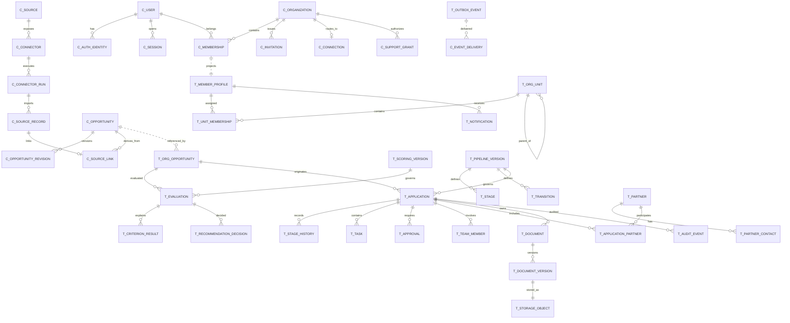

# Proposta de Modelo Lógico de Dados Futuro

## Resultado da revisão

Adotar dois modelos PostgreSQL coordenados:

- **Base central C4G:** identidade global, organizações, memberships, catálogo central, conectores, administração da plataforma e diretório dos tenants.
- **Base de organização:** estrutura, permissões detalhadas e todos os dados operacionais privados do cliente.

As bases partilham identificadores UUID estáveis, mas não foreign keys distribuídas. A consistência entre bases é feita por eventos idempotentes com outbox/inbox e reconciliação.

Esta proposta foi aceite e promovida para `context/decisions/future-data-model.md`. Este ficheiro permanece como estudo detalhado; a decisão promovida prevalece quando introduz especificações adicionais.

## Decisões confirmadas

- Produto C4G multi-instituição para universidades, municípios e empresas.
- Identidade e memberships centralizadas; credenciais não são duplicadas.
- Uma base Neon central e uma base/projeto Neon por cliente.
- Membership central é a fonte de verdade do acesso.
- Catálogo central C4G e oportunidades privadas por organização.
- Qualificação separada de candidaturas.
- Matching determinístico, explicável e sem IA no MVP.
- Pipeline, tarefas, uma aprovação interna e documentos configuráveis.
- Histórico preservado; oportunidades e candidaturas são arquivadas, não eliminadas automaticamente.
- R2 para objetos e Resend através de outbox processada pelo worker.
- Reporting isolado por organização e baseado em factos históricos.
- A implementação UBI atual é fonte de dados para migração, não modelo futuro.

As entidades, identificadores UUID, máquinas de estados e estratégia de snapshots foram aceites como baseline lógico. Nomes físicos e tipos exatos ficam para o futuro dicionário de dados.

## Convenções recomendadas

- **Identificadores:** UUID v7 gerados pela aplicação para entidades partilhadas, sincronizadas, auditadas ou expostas pela API. IDs internos sem circulação entre bases podem também usar UUID para uniformidade.
- **Tempo:** `timestamptz` em UTC; datas civis como `date`; guardar timezone da organização separadamente.
- **Arquivo:** `archived_at`, `archived_by` e `archive_reason`; evitar `deleted_at` para entidades de negócio preservadas.
- **Concorrência:** `version` inteiro ou `updated_at` comparado em writes sensíveis.
- **Snapshots:** JSON estruturado apenas para evidência histórica; dados consultáveis e invariantes permanecem normalizados.
- **Enums evolutivos:** códigos semânticos estáveis em tabelas de referência; labels configuráveis não são usados como chaves.
- **Contexto:** eventos, jobs, auditoria e objetos incluem sempre `organization_id`, mesmo numa base dedicada.

# 1. Base central C4G

## Identidade, autenticação e organizações

| Entidade | Responsabilidade e identificador | Relações e cardinalidades | Ciclo de vida, invariantes e histórico |
| --- | --- | --- | --- |
| `user` | Identidade global; `user_id` UUID | 1:N `auth_identity`, 1:N `session`, N:M `organization` por membership | `PENDING`, `ACTIVE`, `SUSPENDED`, `ANONYMIZED`. E-mail normalizado único quando presente. Suspensão bloqueia acesso global. Anonimização preserva ID e histórico, remove/substitui PII conforme política. |
| `auth_identity` | Método de autenticação; `auth_identity_id` UUID | N:1 `user`; combinação fornecedor + subject externa única | `ACTIVE`, `DISABLED`, `REVOKED`. Guarda referência do fornecedor e metadados mínimos; nunca credenciais em claro. Histórico de ligações/desligações auditado. |
| `session` | Sessão revogável; `session_id` UUID aleatório | N:1 `user`; pode referir organização selecionada | `ACTIVE`, `REVOKED`, `EXPIRED`. Token persistido apenas como hash/referência. Mudança crítica revoga ou invalida imediatamente. Histórico técnico retido por prazo limitado. |
| `mfa_method` | Métodos MFA do utilizador; `mfa_method_id` UUID | N:1 `user` | `PENDING`, `ACTIVE`, `REVOKED`. Segredos protegidos pelo fornecedor/cofre; recuperação e alterações auditadas. |
| `organization` | Cliente/tenant; `organization_id` UUID | 1:N memberships, convites, ligações e grants de suporte | `PROVISIONING`, `ACTIVE`, `SUSPENDED`, `ARCHIVED`. Slug/domínio único conforme política. Suspensão impede acesso; arquivo preserva metadados e localização de dados. |
| `organization_membership` | Vínculo e perfil base; `membership_id` UUID | N:1 `user`, N:1 `organization`; 1:1 projeção local lógica | `INVITED`, `PROVISIONING`, `ACTIVE`, `SUSPENDED`, `REMOVED`, `ERROR`. `UNIQUE(user_id, organization_id)`. Apenas `ACTIVE` concede acesso. Perfil base: org admin, funding manager, collaborator ou viewer. Mudanças produzem eventos. |
| `invitation` | Convite para organização; `invitation_id` UUID | N:1 organization; opcional N:1 inviter/user | `PENDING`, `ACCEPTED`, `EXPIRED`, `REVOKED`. Token apenas em hash, e-mail normalizado, validade e perfil proposto. Aceitação é idempotente. |
| `organization_auth_config` | Domínios, SSO e políticas de autenticação; `auth_config_id` UUID | 1:N por organização, uma configuração ativa por tipo | Versionada; secrets são referências externas. Alterações auditadas e não alteram sessões sem política explícita. |

## Diretório, administração e suporte

| Entidade | Responsabilidade e identificador | Relações e cardinalidades | Ciclo de vida, invariantes e histórico |
| --- | --- | --- | --- |
| `organization_connection` | Localização e credenciais indiretas da base do cliente; `connection_id` UUID | N:1 organization; uma ligação ativa por ambiente | `PROVISIONING`, `ACTIVE`, `DEGRADED`, `ROTATING`, `DISABLED`. Guarda provider/project/database e `secret_ref`, nunca password. A API escolhe a ligação apenas após validar membership. |
| `tenant_schema_state` | Versão e saúde do esquema do cliente; `organization_id` + ambiente | 1:1 ligação ativa | Guarda versão desejada/aplicada, última verificação, erro e lock de migração. Fonte de verdade operacional do rollout multi-base. |
| `platform_admin_assignment` | Privilégio global C4G; `assignment_id` UUID | N:1 user | `ACTIVE`, `REVOKED`, com função C4G. Nunca é membership de cliente. Concessão e revogação exigem auditoria forte. |
| `support_access_grant` | Autorização temporária de suporte a dados de cliente; `grant_id` UUID | N:1 organization, N:1 utilizador C4G, N:1 autorizador | `REQUESTED`, `APPROVED`, `ACTIVE`, `EXPIRED`, `REVOKED`. Escopo, motivo e validade obrigatórios; cada uso referencia o grant. |
| `platform_audit_event` | Evidência imutável de administração central/suporte; `audit_event_id` UUID | Refere actor, organization e grant quando aplicável | Append-only. Snapshot mínimo do actor, ação, alvo, resultado, IP/session/correlation. PII minimizada; retenção definida por política. |

## Catálogo central e integrações

| Entidade | Responsabilidade e identificador | Relações e cardinalidades | Ciclo de vida, invariantes e histórico |
| --- | --- | --- | --- |
| `opportunity` | Registo canónico central; `opportunity_id` UUID | 1:N revisões, N:M fontes por source record, N:M termos | `DRAFT`, `PUBLISHED`, `CLOSED`, `UNAVAILABLE`, `ARCHIVED`. Não é estado de qualificação. Nunca eliminado por desaparecimento externo. Campos canónicos incluem título, programa, financiador, geografia, datas, orçamento, taxa, beneficiários, parceria, tipologia, objetivos e elegibilidade. |
| `opportunity_revision` | Snapshot histórico do canónico; `revision_id` UUID | N:1 opportunity; refere causa/run/actor | Append-only, número sequencial único por oportunidade. Guarda campos relevantes e diff/resumo. Organizações podem referir a revisão usada numa avaliação. |
| `source` | Fonte lógica oficial/manual; `source_id` UUID | 1:N connectors e source records | `ACTIVE`, `PAUSED`, `RETIRED`. Tipo, proprietário C4G/privado, URL e política de uso. CORDIS classificado como histórico/projetos. |
| `connector` | Configuração/versionamento do adaptador; `connector_id` UUID | N:1 source; 1:N runs | `DRAFT`, `ACTIVE`, `PAUSED`, `RETIRED`. Versão do adaptador, schedule, limites e `secret_ref`. Não contém lógica específica no núcleo. |
| `connector_run` | Execução observável; `run_id` UUID | N:1 connector; 1:N records/errors | `QUEUED`, `RUNNING`, `SUCCEEDED`, `PARTIAL`, `FAILED`, `CANCELLED`. Contagens, duração, referência da fonte e erro resumido. Estado terminal obrigatório. |
| `external_opportunity_record` | Registro bruto normalizado por fonte; `source_record_id` UUID | N:1 source, N:1 run, opcional N:1 opportunity | Chave única `(source_id, external_identifier)` quando disponível; payload bruto referenciado/versionado, hash, first/last seen. Desaparecimento marca `MISSING/UNAVAILABLE`, não elimina. |
| `opportunity_source_link` | Proveniência entre canónico e record externo; chave UUID | N:1 opportunity e N:1 source record | Uma ligação ativa por source record. Guarda confiança, método e decisão de merge; histórico preservado em eventos/revisões. |
| `duplicate_candidate` | Possível duplicado; `candidate_id` UUID | Liga dois opportunities ou source records | `PENDING`, `MERGED`, `DISTINCT`, `IGNORED`. Score e razões determinísticas; decisão humana e actor preservados. |
| `taxonomy` / `taxonomy_version` / `taxonomy_term` | Vocabulários C4G partilhados; UUIDs | Taxonomy 1:N versões; versão 1:N termos; termos podem ter parent | Versões `DRAFT`, `PUBLISHED`, `RETIRED`; publicadas são imutáveis. Códigos semânticos estáveis; labels traduzíveis/configuráveis fora do código. |
| `opportunity_term` | Classificação do canónico | N:M opportunity/term; refere taxonomy version | Guarda origem automática/manual, confiança e actor. Alterações criam revisão ou histórico próprio. |

## Eventos centrais

| Entidade | Responsabilidade e identificador | Relações e cardinalidades | Ciclo de vida, invariantes e histórico |
| --- | --- | --- | --- |
| `outbox_event` | Evento transacional a publicar; `event_id` UUID | Refere aggregate type/id e organization | Criado na mesma transação da mudança. `PENDING`, `PUBLISHED`, `FAILED`; payload versionado, contador e próxima tentativa. `event_id` é chave de idempotência. |
| `event_delivery` | Estado por consumidor/destino; chave `(event_id, consumer)` | N:1 outbox event | Regista tentativas, sucesso ou dead-letter. Não substitui a inbox do cliente. |
| `platform_email_event` | Índice mínimo de e-mail e webhooks Resend; `message_id` UUID | Refere organização e outbox local/central por UUID | Estados `QUEUED`, `SENT`, `DELIVERED`, `DELAYED`, `BOUNCED`, `FAILED`, `COMPLAINED`. Evitar duplicar conteúdo/PII; guardar provider ID, idempotency key e eventos necessários à auditoria. |

# 2. Base de cada organização

Cada base guarda `organization_id` nos contextos e eventos, embora só contenha dados de um cliente. Uma constraint/configuração local deve impedir outro UUID organizacional.

## Pessoas, unidades, permissões e configuração

| Entidade | Responsabilidade e identificador | Relações e cardinalidades | Ciclo de vida, invariantes e histórico |
| --- | --- | --- | --- |
| `organization_member_profile` | Projeção local da membership; `membership_id` igual ao central | 1:1 membership central; N:M unidades/equipas | `PROVISIONING`, `ACTIVE`, `SUSPENDED`, `REMOVED`. Guarda `global_user_id`, cargo/função, preferências e dados locais. Não decide acesso central. PII global não é copiada salvo snapshot explícito. |
| `organizational_unit` | Hierarquia configurável; `unit_id` UUID | Auto-relação parent 0..1:N; N:M membros, oportunidades e candidaturas | `ACTIVE`, `ARCHIVED`. Sem ciclos; uma unidade pertence a uma organização. Arquivo não apaga associações históricas. Recomenda-se parent adjacency + tabela closure para consultas de âmbito. |
| `organizational_unit_path` | Fecho transitivo da hierarquia | ancestor/descendant N:M com depth | Derivada e reconciliável; unique por par. Atualização de árvore deve ser transacional. |
| `unit_membership` | Associação membro-unidade; `unit_membership_id` UUID | N:1 profile, N:1 unit | `ACTIVE`, `ENDED`; intervalo de validade e `is_primary`. No máximo uma unidade principal ativa por membro. Histórico temporal preservado. |
| `permission_grant` | Exceções/âmbitos locais além do perfil base; `grant_id` UUID | Refere profile ou team; opcional unit/resource | `ACTIVE`, `EXPIRED`, `REVOKED`. Efeito allow/deny conforme política explícita; escopo e validade obrigatórios. Alterações auditadas. |
| `organization_setting` | Configuração local tipada/versionada; `setting_id` UUID | N:1 organization lógica | Preferir colunas/tabelas para invariantes; JSON apenas para configurações extensíveis. Histórico para alterações que afetam regras ou reporting. |

## Competências, prioridades e taxonomias locais

| Entidade | Responsabilidade e identificador | Relações e cardinalidades | Ciclo de vida, invariantes e histórico |
| --- | --- | --- | --- |
| `organization_taxonomy` / `organization_term` | Vocabulários locais ou extensão de taxonomia C4G | 1:N versões/termos; termos podem mapear para termo central | Versionados; códigos locais estáveis. Termos usados historicamente são retirados, não apagados. |
| `competency` | Capacidade da organização/unidade/equipa/pessoa; `competency_id` UUID | Liga termo a owner polimórfico controlado ou tabelas de ligação | `ACTIVE`, `ARCHIVED`; nível, evidência, validade e origem. Alterações preservadas quando usadas em avaliações. |
| `strategic_priority` | Prioridade ponderável; `priority_id` UUID | Pode aplicar à organização ou unidades e termos | Versionada, com período de validade, peso e estado. Publicação torna versão imutável para avaliações históricas. |
| `organization_profile_version` | Snapshot de critérios organizacionais usados no matching | 1:N competências/prioridades/regras versionadas | `DRAFT`, `PUBLISHED`, `RETIRED`. Uma versão publicada é imutável e referenciada por cada avaliação. |

## Oportunidades privadas, matching e qualificação

| Entidade | Responsabilidade e identificador | Relações e cardinalidades | Ciclo de vida, invariantes e histórico |
| --- | --- | --- | --- |
| `organization_opportunity` | Relação privada da organização com uma oportunidade; `organization_opportunity_id` UUID | Opcional `central_opportunity_id` UUID sem FK; ou 1:1 `private_opportunity`; 1:N avaliações, decisões e candidaturas | `NEW`, `IN_ANALYSIS`, `QUALIFIED`, `NOT_RELEVANT`, `ARCHIVED`. Exatamente uma origem: central ou privada. Unique por `central_opportunity_id` dentro da base. Notas, prioridade, owner e unidade são privados. |
| `private_opportunity` | Oportunidade exclusiva do cliente; `private_opportunity_id` UUID | 1:1 organization opportunity; 1:N revisões/source records locais | Mesmo contrato normalizado do canónico. `DRAFT`, `PUBLISHED`, `CLOSED`, `UNAVAILABLE`, `ARCHIVED`. Nunca promovida ao catálogo sem processo explícito. |
| `private_opportunity_revision` | Snapshot histórico local | N:1 private opportunity | Append-only; origem manual/importação e actor/run preservados. |
| `qualification_history` | Histórico de estados de qualificação | N:1 organization opportunity | Append-only: from/to, actor, reason, timestamp e snapshot mínimo. Estado atual deriva/é cache consistente da última transição. |
| `scoring_profile` / `scoring_profile_version` | Configuração de critérios, pesos e elegibilidade | Profile 1:N versions; version 1:N rules | `DRAFT`, `PUBLISHED`, `RETIRED`. Publicada é imutável. Uma versão ativa por âmbito/período conforme regra. |
| `scoring_rule` | Critério determinístico | N:1 profile version | Tipo `ELIGIBILITY` ou `WEIGHTED`; operador, dados requeridos, peso e explicação. Soma/pesos obedecem invariantes documentados. |
| `opportunity_evaluation` | Execução do matching; `evaluation_id` UUID | N:1 organization opportunity; N:1 scoring version; N:1 org profile version | `QUEUED`, `RUNNING`, `COMPLETED`, `INCOMPLETE`, `FAILED`. Guarda revisão da oportunidade, score global e outcome de elegibilidade. Reexecução cria nova avaliação. |
| `criterion_result` | Explicação por critério; `criterion_result_id` UUID | N:1 evaluation, N:1 rule | Guarda resultado, score, correspondências, ausentes, fatores e evidência/snapshot. Imutável após conclusão. |
| `recommendation_decision` | Decisão humana; `decision_id` UUID | N:1 evaluation e organization opportunity | `ACCEPTED`, `REJECTED`, `CORRECTED`; actor, prioridade, unidades, owner e justificação. Não altera o resultado automático; cria decisão separada. |
| `recommendation_feedback` | Correções e resultado observado | N:1 decision/evaluation; opcional N:1 application | Append-only; motivos, critérios corrigidos, conversão e resultado final. No MVP serve ajuste manual. |

## Candidaturas e pipeline

| Entidade | Responsabilidade e identificador | Relações e cardinalidades | Ciclo de vida, invariantes e histórico |
| --- | --- | --- | --- |
| `pipeline` / `pipeline_version` | Workflow configurável | Pipeline 1:N versões; versão 1:N stages/transitions | `DRAFT`, `PUBLISHED`, `RETIRED`. Aplicações referem a versão com que foram criadas; publicação torna versão imutável. |
| `pipeline_stage` | Etapa configurada; `stage_id` UUID | N:1 version; N:1 categoria semântica C4G | Ordem e label locais; código semântico estável. Uma versão deve ter etapa inicial e pelo menos um caminho terminal válido. |
| `pipeline_transition` | Movimento permitido; `transition_id` UUID | N:1 version; from/to stages | Pode permitir regressão; flags para justificação/reabertura. Regras avançadas ficam fora do MVP. |
| `transition_requirement` | Campo, documento, tarefa ou aprovação exigidos | N:1 transition | Versionado com pipeline. Apenas requisitos suportados no MVP podem ficar ativos. |
| `application` | Candidatura concreta; `application_id` UUID | N:1 organization opportunity; N:1 pipeline version; 1:N history/tasks/approvals/team/documents | `ACTIVE`, `TERMINAL`, `ARCHIVED`; estado funcional é stage atual. Uma oportunidade pode ter várias candidaturas. Responsável principal obrigatório. Valores monetários distinguem investimento, solicitado, aprovado e cofinanciamento, com moeda. |
| `application_stage_history` | Transições imutáveis; `history_id` UUID | N:1 application; from/to stage e transition | Append-only; actor, timestamp, reason, pipeline version, correlation e snapshots necessários. Reabertura terminal exige evento autorizado. |
| `application_unit` | Unidades participantes | N:M application/unit | Intervalo e função; uma unidade pode ser principal conforme regra. Histórico preservado para reporting. |
| `application_team_member` | Pessoa/equipa/unidade participante e função | N:1 application; refere profile, team ou unit conforme tipo | `ACTIVE`, `ENDED`; role code configurável, datas e âmbito. Exatamente um responsável principal ativo. |
| `task_template` | Tarefa automática de uma etapa | N:1 pipeline version/stage | Imutável com a versão publicada. Define prazo relativo, prioridade, role responsável e se bloqueia transição. |
| `application_task` | Trabalho executável; `task_id` UUID | N:1 application; opcional template; assignee profile/team/unit | `OPEN`, `IN_PROGRESS`, `DONE`, `CANCELLED`; prazo, prioridade e conclusão. Tarefa obrigatória incompleta pode bloquear transição. Histórico de alterações preservado. |
| `approval` | Pedido e decisão interna; `approval_id` UUID | N:1 application; opcional transition | `PENDING`, `APPROVED`, `REJECTED`, `CANCELLED`. No MVP, uma aprovação ativa por gate. Decisor, decisão, data e comentário imutáveis após conclusão; nova decisão cria novo ciclo. |

## Equipas e parceiros

| Entidade | Responsabilidade e identificador | Relações e cardinalidades | Ciclo de vida, invariantes e histórico |
| --- | --- | --- | --- |
| `team` | Agrupamento interno reutilizável; `team_id` UUID | N:M profiles/units; N:M applications | `ACTIVE`, `ARCHIVED`. Nome único apenas no âmbito definido. Arquivo preserva participação histórica. |
| `team_membership` | Membro e função na equipa | N:1 team; N:1 profile | `ACTIVE`, `ENDED`; datas e função. |
| `partner_organization` | Entidade externa reutilizável; `partner_id` UUID | 1:N contactos; N:M aplicações | `ACTIVE`, `ARCHIVED`, opcional `MERGED`. Identificadores fiscais apenas quando necessários e protegidos. Merge preserva alias e referências. |
| `partner_contact` | Pessoa de contacto externa; `contact_id` UUID | N:1 partner | `ACTIVE`, `ARCHIVED`, `ANONYMIZED`. PII sujeita a retenção e direitos. Snapshot em candidatura quando necessário ao histórico. |
| `application_partner` | Participação do parceiro na candidatura | N:1 application, N:1 partner | Função, estado, responsabilidade e intervalo. Histórico preservado mesmo se parceiro for arquivado. |

## Documentos e R2

| Entidade | Responsabilidade e identificador | Relações e cardinalidades | Ciclo de vida, invariantes e histórico |
| --- | --- | --- | --- |
| `document` | Agregado lógico; `document_id` UUID | N:1 application; 1:N versions | `ACTIVE`, `ARCHIVED`. Categoria e estado documental; não contém caminho local. |
| `document_version` | Versão imutável do ficheiro; `document_version_id` UUID | N:1 document; 1:1 storage object lógico | `PENDING_UPLOAD`, `AVAILABLE`, `QUARANTINED`, `FAILED`, `SUPERSEDED`, `ARCHIVED`. Número único crescente; autor, hash, MIME, tamanho e timestamp. |
| `storage_object` | Metadados do objeto R2; `storage_object_id` UUID | 1:1 document version/import/export | `PENDING`, `AVAILABLE`, `DELETE_PENDING`, `DELETED`, `ORPHANED`, `ERROR`. Guarda bucket/key opacos, checksum e provider ETag; key inclui organization context. |
| `document_requirement` | Documento exigido por etapa/transição | N:1 pipeline version/stage/transition | Imutável na versão publicada; categoria, multiplicidade e bloqueio. Cumprimento é calculado sobre versões disponíveis. |
| `storage_reconciliation` | Resultado de reconciliação DB/R2 | N:1 storage object ou run | Append-only/retido operacionalmente; deteta objetos sem registo e registos sem objeto. Eliminação é saga idempotente, nunca operação única assumida atómica. |

## Notificações, e-mail, reporting e auditoria

| Entidade | Responsabilidade e identificador | Relações e cardinalidades | Ciclo de vida, invariantes e histórico |
| --- | --- | --- | --- |
| `notification` | Notificação in-app local; `notification_id` UUID | N:1 recipient membership; opcional recurso | `UNREAD`, `READ`, `ARCHIVED`. `dedupe_key` única por recipient quando aplicável. Conteúdo histórico pode usar snapshots mínimos. |
| `notification_preference` | Preferência por canal/tipo | N:1 profile | Versionada/auditada quando afeta comunicações obrigatórias. Não pode desativar avisos legais obrigatórios. |
| `email_outbox` | Comando transacional para Resend; `email_id` UUID | Refere notification/event/resource | `PENDING`, `PROCESSING`, `SENT`, `DELIVERED`, `DELAYED`, `BOUNCED`, `FAILED`, `COMPLAINED`. Idempotency key única; conteúdo/snapshot conforme retenção. Worker e webhook atualizam por eventos idempotentes. |
| `metric_definition` / `metric_definition_version` | Fórmula semântica de indicador | Pode ser réplica de definição C4G central ou local | Versões publicadas imutáveis. Código semântico, fórmula, dimensões, tratamento de ausentes e validade. |
| `reporting_fact` | Projeção/agg regenerável para dashboards | Refere entidades e versões históricas | Derivada; não é source of truth. Inclui `as_of` e versão. Falha de refresh não altera dados operacionais. Para MVP pode ser materialized view/tabela incremental. |
| `report_export` | Pedido e resultado de exportação | Refere actor, filtros e storage object | `QUEUED`, `RUNNING`, `READY`, `EXPIRED`, `FAILED`. Filtros e âmbito autorizados ficam em snapshot; objeto R2 expira segundo política. |
| `audit_event` | Evidência local imutável; `audit_event_id` UUID | Refere actor global/membership, sessão, recurso, support grant opcional | Append-only. `organization_id`, ação, alvo, resultado, before/after seletivo, correlation e timestamp. PII minimizada; sem edição ou cascade delete. |
| `outbox_event` / `inbox_event` | Integração idempotente local | Outbox refere agregado; inbox keyed por event/consumer | Outbox criada na transação do domínio. Inbox `UNIQUE(event_id, consumer)` garante once-effect apesar de at-least-once delivery. Dead-letter e reconciliação preservam erro. |

# 3. Diagrama lógico

Prefixo `C_` representa a base central e `T_` a base da organização. Ligações tracejadas são referências UUID/eventos sem foreign key entre bases.

# 4. Decisões transversais recomendadas

## Identificadores e referências entre bases

- Usar UUID v7 gerado na aplicação; não depender de sequências locais para objetos que cruzam fronteiras.
- `organization_id`, `global_user_id`, `membership_id`, `central_opportunity_id`, `event_id` e `correlation_id` mantêm o mesmo valor em todos os sistemas.
- Não criar foreign keys entre bases. Validar referências no serviço e reconciliar periodicamente.
- Não expor `organization_connection` nem permitir que o frontend escolha a base.

## Source of truth

| Dado | Source of truth |
| --- | --- |
| Identidade, sessão, organização, membership e perfil base | Base central |
| Localização/versão da base cliente | Base central |
| Catálogo e proveniência central | Base central |
| Perfil local, unidades e permissões detalhadas | Base cliente |
| Relação privada com oportunidade e matching | Base cliente |
| Candidaturas, equipas, parceiros e documentos | Base cliente |
| Objeto binário | R2; a base cliente controla metadados e autorização |
| Estado de e-mail | Outbox local + eventos Resend; índice técnico mínimo central quando necessário |
| Relatórios | Dados operacionais/históricos locais; projeções são derivadas |

## Outbox, inbox e idempotência

- A mutação e o respetivo `outbox_event` são gravados na mesma transação local.
- O worker publica com entrega pelo menos uma vez.
- Cada consumidor regista `event_id + consumer` antes/depois do efeito na mesma transação.
- Handlers devem produzir o mesmo resultado em reprocessamento.
- Comandos externos usam idempotency key estável: upload finalization, Resend, importação, exportação e provisionamento.
- Eventos têm `event_type`, `schema_version`, aggregate, organization, occurred_at, correlation e causation IDs.
- Mudanças incompatíveis exigem nova versão do payload; consumidores antigos não recebem shape silenciosamente alterado.

## Versionamento

- Pipeline, scoring profile, organization profile, taxonomy e metric definition usam cabeçalho mutável + versões imutáveis publicadas.
- Entidades operacionais referem sempre a versão efetivamente usada.
- Edições criam draft e nova versão; nunca alteram resultados históricos.
- Labels podem mudar sem alterar códigos semânticos.

## Snapshots históricos

Guardar apenas quando a referência atual não é suficiente para reconstruir o passado:

- actor display name/role efetivo em auditoria, minimizado;
- revisão da oportunidade usada na avaliação/candidatura;
- pesos, critérios e evidências de cada avaliação;
- pipeline/stage/transition e requisitos usados;
- valores financeiros e moeda no momento da submissão/decisão;
- filtros e âmbito autorizado de exportações;
- nome/função de parceiro/contacto quando necessário ao dossier histórico.

Não usar snapshots como identidade alternativa nem copiar e-mail/PII indiscriminadamente.

## Consistência R2

- Fluxo recomendado: criar versão `PENDING_UPLOAD` e objeto `PENDING`; emitir URL assinada; cliente envia; API confirma checksum/metadata; transação marca `AVAILABLE`.
- Download exige sessão, membership e autorização local antes do URL assinado.
- Arquivo mantém objeto segundo retenção. Eliminação física, quando legalmente permitida, usa `DELETE_PENDING` e worker idempotente.
- Reconciliação periódica identifica uploads expirados, objetos órfãos e registos sem objeto.

## Provisionamento e migrações

- Provisionamento é saga: criar organization `PROVISIONING`, criar Neon, aplicar baseline, validar versão, criar perfil do primeiro admin, ativar organization.
- Cada base mantém tabela local de migrações; a central mantém `tenant_schema_state` para orquestração.
- Migrar em lotes pequenos, com lock por tenant, preflight, backup/ponto de recuperação, timeout, verificação e rollback/forward-fix definido.
- API deve conhecer intervalo de versões compatíveis e bloquear writes quando o esquema estiver incompatível.
- Instalações dedicadas seguem as mesmas versões e manifestos.

# 5. Arquivo e anonimização

## Regras recomendadas

- Entidades de negócio com valor histórico são arquivadas: opportunity, organization opportunity, application, pipeline version, units, teams e partners.
- Registos imutáveis não fazem cascade delete: audit, stage history, evaluation, criterion results, connector runs e revisions.
- Relações operacionais usam estado/intervalo (`ended_at`) para preservar participação histórica.
- Pedidos de apagamento de utilizador anonimizarão PII global quando legalmente permitido; IDs e eventos permanecem pseudonimizados para integridade/auditoria.
- Contactos externos podem ser anonimizados separadamente.
- Convites, sessões, tokens, logs técnicos, exports e e-mails devem ter retenções curtas e explícitas.
- Documentos seguem categoria, obrigação contratual/legal e estado da candidatura; arquivo lógico não implica retenção infinita do binário.
- Nunca propagar anonimização para destruir dados financeiros ou históricos sem avaliar obrigação legal e relação contratual.

# 6. Estratégia de migração do piloto UBI

## Princípio

Não transformar incrementalmente a base antiga na arquitetura multi-base. Criar os novos esquemas e executar uma migração ETL validada, mantendo o piloto read-only durante cutover.

## Fases

1. **Inventário e qualidade:** congelar versão do esquema, contar entidades, localizar duplicados, anexos em falta, utilizadores inativos e estados inválidos.
2. **Criar tenant UBI:** organization central, ligação Neon e base cliente vazia na versão alvo.
3. **Identidades:** mapear cada `users` para `user` global e membership UBI; resolver e-mails duplicados antes de importar. `ADMIN` passa a org admin; `PROFESSOR` passa a collaborator/role local a confirmar.
4. **Estrutura:** converter faculties, research centers e professor affiliations em organizational units hierárquicas e unit memberships. Preservar IDs antigos numa tabela de migration mapping, não como chaves primárias novas.
5. **Taxonomias/competências:** importar research areas como taxonomia/configuração UBI, não global; professor areas tornam-se competências/associações locais.
6. **Catálogo:** deduplicar opportunities contra o catálogo central. Oportunidades comuns ligam a `central_opportunity_id`; registos sem correspondência tornam-se privadas UBI até revisão.
7. **Qualificação:** criar `organization_opportunity` para oportunidades relevantes existentes. Não inferir decisão humana além do evidenciado; marcar dados migrados e nível de confiança.
8. **Candidaturas:** mapear applications para pipeline inicial versionado; converter status legado em categorias semânticas; importar membros, partners, history e valores financeiros. Registar regras de mapeamento e exceções.
9. **Documentos:** copiar ficheiros existentes para R2, calcular checksum, criar document/version/storage metadata; listar ficheiros ausentes ou órfãos para decisão humana.
10. **Notificações e integrações:** migrar apenas histórico necessário; connector runs/import batches podem ser preservados como arquivo técnico, sem reativar configurações antigas.
11. **Reconciliação:** comparar contagens, somas financeiras, memberships, candidaturas, anexos e amostras funcionais; produzir relatório assinado de exceções.
12. **Cutover:** parar writes antigos, executar delta final, validar, mudar routing e manter base antiga read-only por período acordado.

## Mapeamentos que exigem decisão

- `PROFESSOR` para perfil base e função local.
- Status legados de candidatura para stages do pipeline inicial.
- `university_budget` para valor solicitado/aprovado/afeto à organização.
- Oportunidades importadas que devem integrar o catálogo central versus permanecer privadas.
- Retenção de notificações, outbox antiga e logs técnicos.

# 7. Riscos e alternativas relevantes

| Risco | Recomendação | Alternativa e custo |
| --- | --- | --- |
| Muitas bases aumentam custo operacional de migrations e conexões | Orquestrador central, pool limitado/cacheado e schema state por tenant | Base partilhada simplifica operação, mas contradiz a decisão de isolamento principal |
| Referências cross-database podem ficar órfãs | UUID estável, eventos, inbox e reconciliação | Replicar objetos centrais completos reduz leituras, mas cria conflitos e maior duplicação |
| Modelo configurável tornar-se excessivamente genérico | Normalizar invariantes; usar JSON apenas em configuração/extensão | EAV universal acelera alterações iniciais, mas prejudica validação, queries e reporting |
| Histórico e snapshots aumentam volume | Snapshots seletivos e políticas de retenção por classe | Recalcular usando configuração atual é menor, mas produz reporting historicamente incorreto |
| R2 e PostgreSQL não têm transação comum | Máquina de estados e saga de reconciliação | Upload através da API simplifica confirmação, mas aumenta carga e não elimina falhas parciais |
| Projeção local de membership fica atrasada | Validação central obrigatória antes do tenant e bloqueio imediato | Confiar na projeção melhora autonomia, mas viola a fonte de verdade confirmada |

# 8. Perguntas abertas

1. Organizações podem criar taxonomias totalmente próprias ou apenas estender taxonomias C4G?
2. Oportunidades privadas podem ser propostas para promoção ao catálogo central? Quem aprova e como se trata a proveniência?
3. Qual tecnologia de jobs/eventos implementará retries, scheduling e dead-letter no MVP?
4. Que versões de esquema simultâneas a API deve suportar durante rollouts graduais?
5. Quais campos personalizados são realmente necessários no MVP? Evitar introduzir EAV/JSON genérico sem casos confirmados.
6. Quais são os prazos concretos de retenção e requisitos de residência por contrato?
7. Que fontes de taxas de câmbio serão aprovadas?
8. Que consentimento e governação seriam exigidos por uma futura rede global de parceiros?

# 9. Recomendação

O modelo foi aceite como baseline e promovido para `context/decisions/future-data-model.md`, com Keycloak, retenção versionada por classe, catálogo local de parceiros e modelo monetário ISO 4217.

O próximo artefacto deve separar os contratos central e tenant num dicionário de dados e matriz de ownership antes de desenhar SQL ou migrations.

## Fontes internas

- `context/project-overview.md` — visão, utilizadores, âmbito e princípios de dados.
- `context/architecture.md` — distribuição central/cliente, Neon, R2, Resend e worker.
- `context/features/opportunity-catalog.md` — catálogo, proveniência, deduplicação e qualidade.
- `context/features/matching-and-qualification.md` — critérios, versões, explicabilidade e feedback.
- `context/features/application-pipeline.md` — etapas, transições, tarefas, aprovação e documentos.
- `context/features/reporting.md` — métricas, dimensões, histórico e exportações.
- `context/decisions/multi-tenant-identity-and-data.md` — identidade global, membership e sincronização.
- `context/decisions/hosting-and-external-services.md` — base por organização e serviços externos.
- `context/references/current-implementation.md` e `backend/database/*.sql` — modelo UBI existente e restrições da migração.

**Next step:** produzir o dicionário lógico de dados central e tenant, sem SQL, a partir da decisão promovida.
