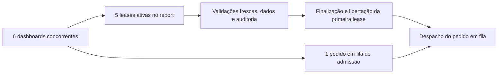

# Investigação da variação de admissão e do host C6

Estado: investigação offline concluída, em Review, 27/10/2026. Pedido: investigar a variação de admissão e a interferência do host, mantendo o SLO `c6-admission-v1`.

Âmbito: analisar offline as duas séries AB/BA preservadas com contador v2, a anterior aprovada (`c6-dedicated-slo-repeat`) e a nova reprovada (`c6-regression-20261027-01`), confrontando admissão, checkout físico, retenção, queries/locks e telemetria Node/Windows. Confirmar integridade das fontes antes de derivar métricas. Não combinar amostras das séries para alterar o gate nem apagar resultados inválidos.

Critérios: identificar os pontos de espera e diferenças mensuráveis; distinguir causalidade demonstrada, associação e lacunas de observação; explicar as violações de ambiente sem as usar como causa exclusiva das ultrapassagens; propor a menor verificação adicional necessária. Preservar SLO, limites, autoridade, durabilidade, runtime, migrations, permissões, dados Dev e deploy.

A investigação usa apenas ficheiros existentes e código de análise novo nesta pasta. Sem carga HTTP/OIDC, Docker, pausa de serviços ou nova reserva do computador. Fontes e evidências originais ficam read-only; [baseline](baseline.json) fixa HEAD/branch/worktree antes da análise. Não é uma nova execução do gate nem aprovação produtiva.

## Conclusão e grau de certeza

**A causa imediata da espera máxima está identificada:** o sexto dashboard espera capacidade enquanto as cinco primeiras leases executam o report. A variação acompanha a duração dessa ocupação, e não uma fila de ligações físicas PostgreSQL. A causa exclusiva do aumento do custo de execução — aplicação, driver, instrumentação, GC ou condições de CPU/VM — **não é identificável com a telemetria guardada**.

O sinal mais forte é a mudança de regime no processo Node instrumentado, presente nas mesmas variantes e já visível no aquecimento sem fila. CPU de fundo explica a invalidação dos bursts 9/11, mas não explica sozinha os máximos observados nem identifica os processos responsáveis. Nenhum resultado justifica aumentar pools/timeouts, eliminar verificações frescas ou reduzir auditoria.

Base quantitativa: [análise reproduzível](analyze.js), [144 pedidos/432 admissões em 24 bursts](analysis.json) e [execução](analysis.log). As duas séries permanecem separadas; não são uma amostra única para aprovar o SLO.

## 1. Onde o pedido espera

Nos **24/24 bursts**, a maior espera ocorre na **primeira admissão**, com `before.active=5`. Os máximos amostrados são sempre **5 ativos e 1 em fila**. As admissões posteriores ficam até 467,72 ms na série anterior e 553,91 ms na nova.

O [dashboard](../../../backend/src/routes/organizationDashboardRoutes.js), linhas 31–34, executa sequencialmente report, resumo privado e contexto final; a primeira lease pertence ao report. O [pool manager](../../../backend/src/security/tenantPoolManager.js), linhas 75–80, aplica o limite tenant; 444–457 reservam capacidade antes do checkout; 484–495 libertam-na depois de libertar o cliente; 535–547 despacham a fila. O [executor](../../../backend/src/security/tenantLeaseExecutor.js), linhas 173–204 e 365, conserva a lease durante revalidações, auditoria, COMMIT/finalização e só depois a liberta.

Checkout físico tenant: máximos por burst de **21,47–62,51 ms** anteriormente e **16,75–74,15 ms** na nova série. O campo `waiting` à entrada dos checkouts é zero em todos; isto não prova ausência de qualquer espera transitória, mas não suporta explicar 4–5 s por saturação do pool físico. O grosso da espera está antes do checkout, na admissão lógica.

Entre os cinco pedidos admitidos diretamente, a menor retenção física inicial na nova série é **2,490–4,900 s**. Excede a espera máxima de admissão em apenas **134,73–207,44 ms**, coerente com o sexto pedido chegar depois e aguardar a primeira libertação. Não reconstruímos uma timeline exata: faltam timestamps/identidade de cada allocation. Nas 432 admissões, a lease adquirida conserva **14999–15000 ms**; a espera consome o timeout de aquisição de 5 s, não o prazo posterior da lease de 15 s.

Limitação importante da instrumentação: `Pool.connect` usa o AsyncLocalStorage corrente (`instrumentation.js:50–64`). Uma tarefa despachada pela fila pode herdar o contexto do pedido que libertou capacidade; nesse caso, o checkout pode aparecer no registo desse pedido. Não associar todos os checkouts às três leases pela posição no array. A comparação acima usa apenas o primeiro checkout dos cinco pedidos admitidos diretamente; as restantes métricas de checkout são agregadas por burst.

## 2. Dois regimes com as mesmas fontes e consultas

Exemplo dentro da **mesma variante B**, ambos com controlos declarados de ambiente aprovados:

| Medida | Burst 6, menor duração | Burst 3, maior duração |
| --- | ---: | ---: |
| Queries medidas no burst | 14526 | 14526 |
| p95 HTTP | 9,836 s | 18,726 s |
| Máximo de admissão | 2,348 s | 4,591 s |
| Menor retenção física inicial | 2,494 s | 4,763 s |
| Metadados: soma de durações do driver, média/pedido | 5,385 s | 9,907 s |
| CPU Node aproximada nas amostras C6 | 6,704 CPU-s | 15,609 CPU-s |
| CPU Node aproximada / query contada | 0,462 ms | 1,075 ms |
| Utilização do event loop, ponderada | 0,551 | 0,761 |
| Máximo atraso do event loop | 52,17 ms | 94,50 ms |
| CPU global, ponderada | 27,59% | 24,95% |
| CPU de fundo média | 3,58% | 3,92% |

CPU/query é uma **normalização do CPU do processo inteiro**, não tempo medido da execução de cada query. O processo inclui API, coordenação do cliente da prova, driver e instrumentação. A integração usa intervalos de 500 ms rotulados pela fase no fim da amostra, podendo incluir parcelas das fases adjacentes. ELU descreve atividade do event loop e não equivale a utilização de CPU, conforme a [documentação Node 24.13.1](https://nodejs.org/download/release/v24.13.1/docs/api/perf_hooks.html#perf_hookseventlooputilizationutilization1-utilization2).

O aquecimento desses mesmos exemplos já difere: **6,086 s vs 9,798 s**, com **2443 queries** em ambos e todas as admissões entrando com `active=0`; máximos de aquisição de apenas 8,15/15,41 ms. O aquecimento inclui custos de primeiro acesso e não é uma réplica C1 normativa, mas mostra que a fila não é a origem de toda a lentidão.

Na nova série, os bursts **1–5, 11 e 12** apresentam máximos de admissão >4 s e aproximadamente 0,993–1,100 ms CPU Node/query. Os bursts **6–10** ficam em 0,423–0,532 ms/query. A e B aparecem nos dois regimes. Este agrupamento é descritivo e feito depois de observar os resultados; não permite excluir bursts nem alterar o gate.

Correlações de Pearson descritivas nos 12 bursts novos: admissão máxima com CPU Node/query **0,990**, retenção mediana **0,985**, metadados **0,980**, ELU **0,978**; com CPU de fundo média **0,422** e pico **0,144**. Variante, ordem e tempo confundem as relações; as observações não são experiências independentes. Correlação não identifica uma causa exclusiva.

## 3. PostgreSQL, locks e custo da instrumentação

As durações do driver crescem em várias categorias, incluindo metadados, protocolo, espera de locks e o próprio sampler SQL. Nos exemplos B acima, a média do sampler durante C6 sobe de **2,308 para 5,436 ms**. Nos bursts mais lentos, aproximadamente **60–64% das observações de sessões não-idle** são `ClientRead`, contra cerca de 52–55% nos mais rápidos.

PostgreSQL define `ClientRead` como espera por dados do cliente. Isso é compatível com trabalho/agendamento do lado Node e round-trips, sem provar qual função o causa. São snapshots, não percentagens de CPU nem decomposição causal do tempo; loops lentos também atrasam o sampler. [Documentação PostgreSQL 17](https://www.postgresql.org/docs/17/monitoring-stats.html#WAIT-EVENT-CLIENT-TABLE).

Os locks centrais e da auditoria continuam presentes; o custo somado cresce, mas não existe evidência de que sejam a causa única. Não somar spans de segurança, durações de queries e retenção como parcelas independentes do tempo HTTP: sobrepõem-se, e a medição do driver inclui scheduling/rede.

Hipóteses descartadas ou delimitadas pela leitura:

- Não há captura de stack em cada query. [instrumentation.js:32](../../../test/integration/http-contention/instrumentation.js) captura apenas no primeiro aparecimento de cada hash; o burst tem 122–123 hashes distintos. SHA-256, classificação, wrappers e contadores continuam por chamada e têm custo ainda não isolado.
- [profile.js:54–66](../../../test/integration/http-contention/profile.js) escreve STAGE antes e MEASURE depois da carga; não há log contínuo por query nesse percurso.
- Contagens, dados sintéticos, fontes A/B, limites e chamadas de autoridade/auditoria mantêm-se. Isso exclui uma alteração de código/volume nestas comparações, não variações do custo por operação ou do ambiente.
- Não se registaram perfis de CPU, GC, frequência efetiva por core, throttling ou CPU da VM/PostgreSQL. Plano de energia constante não demonstra frequência constante.

## 4. Interferência comprovada, atribuição indisponível

O observador [background.ps1:7–25](../../../test/integration/c6-dedicated/background.ps1) guarda apenas CPU agregada do conjunto inicial: **215 processos** na série anterior, **241** na nova, com observados a descer até 231. Não guarda identidade/CPU individual e ignora processos novos; exclui Docker/WSL e o próprio observador. Portanto **não é possível nomear retrospectivamente o processo responsável pelos picos**. O inventário atual do computador não reconstruiria aquela janela.

As violações continuam comprovadas: burst 9, pico **11,185%**; burst 11, média **6,033%** e pico **17,277%**, acima de 5%/10%. Os dois picos estão inteiramente dentro da fase C6. Uma análise de sensibilidade ponderando só a sobreposição dos intervalos com C6 dá médias 5,125% e 6,085%; mantém a reprovação dos mesmos bursts. **Não altera o método nem os veredictos históricos.**

O observador reserializa e reescreve o histórico acumulado a cada segundo (`background.ps1:24–26`), terminando com 760/872 amostras. Esse custo fica fora da CPU de fundo atribuída e não foi medido isoladamente. É uma limitação a quantificar, não uma causa provada; o padrão lento→rápido→lento não permite atribuir a variação apenas ao crescimento do ficheiro.

Os piores máximos A/B, **4,724/4,591 s**, ocorreram nos bursts **4/3**, que passam os controlos existentes. Inversamente, o burst 9 falha o ambiente mas tem admissão máxima de 2,639 s. Logo, interferência agregada e violação da admissão não são equivalentes.

## 5. Próxima verificação concreta

Preparar um incremento separado de instrumentação diagnóstica, antes de nova carga:

1. Identidade por operação/allocation e timestamps monotónicos de enqueue, dispatch, checkout, início de execução, finalização e release. Corrigir a atribuição do contexto da tarefa despachada, preservando argumentos, resultados, erros e identidade da allocation. Distinguir preparação, query module, revalidações finais, auditoria/COMMIT e libertação.
2. CPU/GC do processo Node e perfil amostrado com agregação por módulos/funções, separando aplicação, driver e observadores. Guardar apenas metadados sanitizados, sem parâmetros, SQL, argumentos de processos ou ambiente.
3. CPU por processo com PID e instante de criação, incluindo processos novos/terminados e o observador; categorias sanitizadas e cobertura/inacessibilidade explícitas. Observar distribuição por core e frequência quando disponível; não encerrar serviços do utilizador por inferência.
4. Medir o custo da instrumentação numa prova diagnóstica separada, com e sem profiler, preservando todas as validações. Manter a série normativa e o gate originais; não misturar latências perfiladas com a referência nem alterar SLO/pools/timeouts para obter PASS.

Critérios para essa próxima instrumentação: atribuir as três leases ao pedido certo, reconciliar eventos/contagens, observar todos os erros e libertações, quantificar cobertura/custo do observador, preservar as provas de autoridade/revogação/drift/durabilidade antes de interpretar uma nova série. Nenhuma implementação ou carga deste incremento futuro foi realizada agora.

## Verificação e preservação

Executado `node --check analyze.js` e o analisador offline. Os assertions verificam hashes das fontes, 24 bursts, 144 respostas, 432 admissões, aquecimentos, contagens e invariantes de autoridade/auditoria. Duas revisões independentes read-only confirmaram o mecanismo de admissão e os limites da telemetria; o agente principal cruzou as métricas no script preservado. Não se executaram suites do produto/build, porque não houve alteração de runtime/frontend.

[Conferência final](verification.json): **112 fontes de evidência com hashes íntegros**, 24 máximos na primeira admissão com cinco ativos e nenhum checkout tenant com fila física observada à entrada. [Preservação](preservation.json) PASS: **2973 de 2975 ficheiros anteriores mantêm o hash**; apenas os dois documentos de contexto previstos mudaram, nenhum ficheiro desapareceu, HEAD/branch iguais. Runtime, harness, política, gate e resultados históricos sem mudanças. Apenas esta investigação e os documentos de contexto foram acrescentados/atualizados. Sem SQL, dados Dev, Docker, migrações, permissões, deploy, commit, merge ou push. A conferência por hash não é um snapshot atómico de todo o repositório.

Veredicto: diagnóstico suficiente para localizar a espera e orientar a próxima medição; **falta verificação para atribuir a causa exclusiva do custo Node/host**. O SLO continua inalterado e a última série continua FAIL; não há aprovação produtiva.
